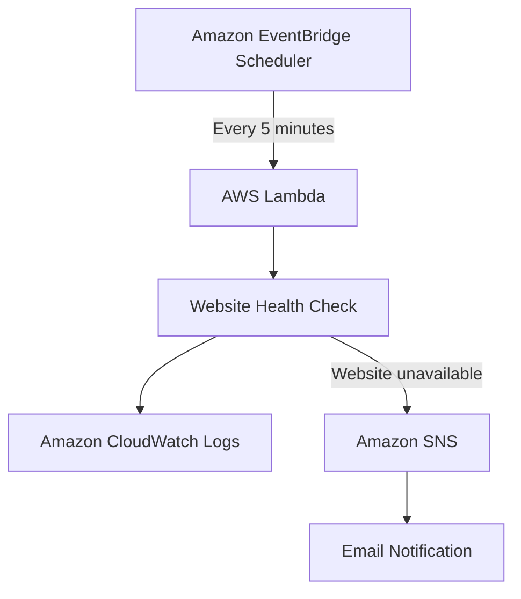

# CloudOps Watch 

### Serverless Website Monitoring & Alerting System

CloudOps Watch is a Python-based serverless monitoring solution that automatically checks website availability and sends email alerts when a website becomes unreachable.

Built using AWS services, this project demonstrates cloud automation, serverless computing, monitoring, alerting, IAM permissions, and automated testing.

##  Architecture

##  Features

- Automated website availability monitoring
- HTTP response status checking
- Website response-time measurement
- Automatic email alerts when a website goes down
- Serverless execution using AWS Lambda
- Scheduled monitoring using EventBridge
- Execution logging through CloudWatch
- IAM-based access control

##  Tech Stack

| Technology | Purpose |
|---|---|
| Python 3.12 | Monitoring logic |
| AWS Lambda | Serverless execution |
| Amazon EventBridge Scheduler | Automated scheduling |
| Amazon SNS | Email notifications |
| Amazon CloudWatch | Logging |
| AWS IAM | Permissions and security |
| GitHub Actions | Automated testing |

##  How It Works

1. EventBridge Scheduler triggers the Lambda function every five minutes.
2. Lambda sends an HTTP request to the configured website.
3. The function checks its availability and measures response time.
4. Results are recorded in CloudWatch.
5. If the website is unavailable, SNS sends an email alert.

##  Testing

The monitoring function was tested using:

- A working website to verify successful HTTP responses.
- An intentionally invalid website address to simulate failure.
- An SNS email notification test to verify alert delivery.

**Result:** Successful website checks and failure email notifications were verified.

##  Security

- IAM execution roles control AWS permissions.
- SNS publishing is restricted to the project's notification topic.
- Environment variables are used for configuration.
- No AWS access keys are stored in the source code.

##  Cost Considerations

This project uses serverless AWS services. Actual charges depend on usage, account eligibility, and service pricing. The monitoring schedule can be disabled when not required.

##  Future Improvements

- CloudWatch custom metrics
- Monitoring dashboard
- Support for multiple websites
- Website uptime percentage reports
- Response-time threshold alerts
- Infrastructure as Code using AWS CloudFormation or Terraform

##  Author

**Pranav Bochkari**

Cloud Computing Student | Aspiring Cloud & DevOps Engineer

GitHub: [@pranavbochkari-dev](https://github.com/pranavbochkari-dev)

---

*Built as a hands-on cloud engineering project to explore AWS serverless architecture and automated monitoring.*
